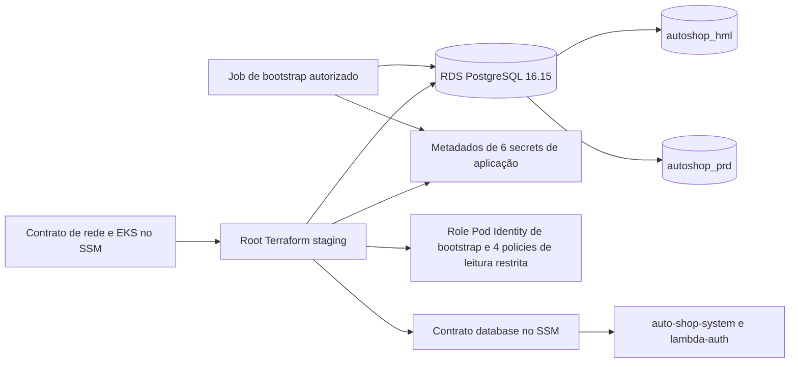

# Database Infra

Provisiona uma única instância PostgreSQL efêmera para o staging do Auto Shop. Os ambientes lógicos `hml` e `prd` são databases separados na mesma instância; `prd` não é um root de produção. O desenho segue o ADR-0071, revisão de 2026-10-25, e as issues #1–#5.

## Repositórios

| Repositório | Responsabilidade nesta integração |
|---|---|
| `k8s-infra` | VPC, subnets isoladas, EKS, security groups de workload, namespace `auto-shop-ops` e o contrato de rede/cluster no SSM. |
| `database-infra` | Uma instância RDS de staging, metadados de Secrets Manager, roles/policies próprios, SQL de bootstrap e contrato de saída no SSM. |
| `auto-shop-system` | Migrations Alembic, ExternalSecrets e consumidores do contrato de staging. |
| `lambda-auth` | Funções que recebem apenas a policy de leitura do segredo Lambda do ambiente correspondente. |

## Tecnologias

- Terraform `>= 1.10.0, < 2.0.0`, provider AWS `~> 6.70` e lock file versionado.
- PostgreSQL 16.15 em `db.t4g.micro`, Single-AZ, gp3 de 20 GiB, dentro das subnets isoladas do staging.
- GitHub Actions com OIDC; este repositório não cria nem altera roles de CI, bucket de state ou permissions boundary. As trust policies dessas roles externas devem restringir audience, repositório e refs autorizadas na conta AWS.
- PostgreSQL client e Docker para os testes locais de permissões SQL.

## Arquitetura



`envs/staging/database` é o único root. A rede lê cinco parâmetros exatos do `k8s-infra`; o root publica os endpoints, nomes, ARNs e policies do banco. Não há root `envs/production`, RDS Proxy, provider PostgreSQL, senha em Terraform, nem valor de secret em outputs ou SSM.

## Estrutura

```text
envs/staging/database/       # Único root; backend S3 e lockfile
modules/db-network/          # Subnets isoladas e regras SG referenciadas por SG
modules/db-instance/         # RDS PostgreSQL efêmero e parameter group
modules/db-secrets/          # Apenas metadados de Secrets Manager
modules/ssm-contract/        # String/StringList sem valores secretos
sql/                         # Bootstrap de roles, defaults de migration e grants pós-migration
scripts/                     # Guard, resumo, smoke, bootstrap e orphan scan
tests/                       # Terraform mocks, testes SQL e contratos de scripts
.github/workflows/           # CI, apply e destroy
```

## Contrato publicado (SSM)

Todos os parâmetros publicados são `String`, tier Standard, na região `us-east-1`. Os cinco parâmetros de entrada abaixo vêm do `k8s-infra`; o plano Terraform falha se houver AccessDenied/rede e só pula o plan quando os nomes exatos estão ausentes.

| Parâmetro | Valor publicado | Leitor esperado |
|---|---|---|
| `/auto-shop/staging/database/host` | Host privado do RDS | deploy do `k8s-infra` e `lambda-auth` |
| `/auto-shop/staging/database/port` | `5432` | os mesmos consumidores |
| `/auto-shop/staging/database/security-group-id` | ID do SG do RDS | `lambda-auth` para validar rede |
| `/auto-shop/staging/database/names/hml` | `autoshop_hml` | configuração do app e Lambda hml |
| `/auto-shop/staging/database/names/prd` | `autoshop_prd` | configuração do app e Lambda prd |
| `/auto-shop/staging/database/secrets/runtime-hml-arn` | ARN `app-runtime` hml | ExternalSecret do `auto-shop-system` |
| `/auto-shop/staging/database/secrets/runtime-prd-arn` | ARN `app-runtime` prd | ExternalSecret do `auto-shop-system` |
| `/auto-shop/staging/database/secrets/lambda-hml-arn` | ARN `lambda-auth` hml | função `lambda-auth` hml |
| `/auto-shop/staging/database/secrets/lambda-prd-arn` | ARN `lambda-auth` prd | função `lambda-auth` prd |
| `/auto-shop/staging/database/secrets/migrations-hml-arn` | ARN da credencial DDL dedicada a `autoshop_hml` | Job de migrations HML |
| `/auto-shop/staging/database/secrets/migrations-prd-arn` | ARN da credencial DDL dedicada a `autoshop_prd` | Job de migrations PRD |
| `/auto-shop/staging/database/secrets/owner-arn` | ARN do master secret gerenciado pelo RDS | somente o Job de bootstrap deste repositório |
| `/auto-shop/staging/database/iam/lambda-read-policy-arn/hml` | ARN da policy de leitura Lambda hml | role da função `lambda-auth` hml |
| `/auto-shop/staging/database/iam/lambda-read-policy-arn/prd` | ARN da policy de leitura Lambda prd | role da função `lambda-auth` prd |
| `/auto-shop/staging/database/iam/migrations-hml-read-policy-arn` | policy de leitura do secret migrations HML | role Pod Identity de migrations HML |
| `/auto-shop/staging/database/iam/migrations-prd-read-policy-arn` | policy de leitura do secret migrations PRD | role Pod Identity de migrations PRD |

Os quatro parâmetros `/iam/` publicam ARNs de policies, nunca valores de credenciais. Cada policy de migrations permite ler apenas o secret do respectivo banco. O root não usa `terraform_remote_state`, `GetParametersByPath`, `SecureString` ou um nome singular `database/name`.

O app-runtime não recebe uma policy duplicada neste repositório: o ESO existente no `k8s-infra` já lê `app-runtime-*` dentro do prefixo staging. Esse wildcard de nome é um tradeoff frente ao critério de ARN literal da issue #4 e precisa de revisão entre repositórios.

## Segredos criados

| Nome | Criado por | Payload | Acesso |
|---|---|---|---|
| `rds!db-<resource-id>` | RDS com `manage_master_user_password=true` | `{username,password}` gerenciado pelo RDS | leitura somente pela role de bootstrap |
| `auto-shop/staging/hml/app-runtime` | metadados no Terraform; payload futuro pelo bootstrap | credencial DML de hml | ESO |
| `auto-shop/staging/prd/app-runtime` | metadados no Terraform; payload futuro pelo bootstrap | credencial DML de prd | ESO |
| `auto-shop/staging/hml/lambda-auth` | metadados no Terraform; payload futuro pelo bootstrap | credencial read-only de hml | policy Lambda hml |
| `auto-shop/staging/prd/lambda-auth` | metadados no Terraform; payload futuro pelo bootstrap | credencial read-only de prd | policy Lambda prd |
| `auto-shop/staging/hml/migrations` | metadados no Terraform; payload futuro pelo bootstrap | credencial DDL limitada a `autoshop_hml` | policy migrations HML |
| `auto-shop/staging/prd/migrations` | metadados no Terraform; payload futuro pelo bootstrap | credencial DDL limitada a `autoshop_prd` | policy migrations PRD |

Terraform cria somente metadados dos seis secrets de aplicação; não declara `aws_secretsmanager_secret_version`, não chama `GetSecretValue` e não grava senha em state. Os seis secrets têm recuperação imediata para que o mesmo nome possa ser recriado na próxima sessão. O master secret permanece gerenciado pelo RDS e só é lido pelo Job de bootstrap.

## Execução

A ordem operacional aprovada é:

```text
k8s-infra apply foundation e platform (inclui auto-shop-ops)
  -> database-infra plan salvo e guard
  -> database-infra apply
  -> bootstrap-db.sh bootstrap e smoke inicial
  -> auto-shop-system migrations Alembic com credencial dedicada por banco
  -> database-infra apply manual com phase=grants
  -> smoke completo hml/prd e prova de restore aprovada
  -> parar consumidores e Lambda
  -> database-infra destroy e orphans sem achados
  -> k8s-infra destroy e orphan check global, após espera
```

Apply é manual via `workflow_dispatch` e requer environment `staging` restrito exatamente à branch `main`, aprovação da sessão e as variáveis `STAGING_ACTIVE=true`, `STAGING_SESSION_AUTHORIZED=true` e `STAGING_SESSION_ID` com o identificador da sessão. O dispatch também exige que `session_id` corresponda à variável ativa; push ou merge em `main` não inicia provisionamento. O preflight verifica a conta `035611741563`, a boundary `auto-shop-boundary`, os cinco parâmetros SSM de entrada e o EKS antes do plan/apply.

O bootstrap operacional está implementado localmente. O Job usa AWS CLI para obter credenciais temporárias e metadados, um init container Python que executa asm-exec para resolver segredos no runtime, postgres:16 para aplicar SQL por TLS e AWS CLI para publicar somente payloads ausentes ou desatualizados via PutSecretValue. Os retries reutilizam os segredos publicados e reaplicam seus verificadores SCRAM aos roles. Credenciais, pgpass, verificadores SCRAM, payloads, CA e temporários do pod ficam no emptyDir em memória. Os temporários do orquestrador local usam /dev/shm por padrão; em hosts sem tmpfs gravável, `BOOTSTRAP_TMP_BASE` e `BOOTSTRAP_ALLOW_NON_TMPFS_TMP=true` permitem indicar um diretório-base existente, privado e controlado pelo operador. O script cria nele um subdiretório com modo restrito. O host guarda metadados SSM, kubeconfig temporário, manifests renderizados, status do Job e logs de comandos; valores de secrets e credenciais AWS do workload ficam no volume `/work` em memória do Job. O operador é responsável por garantir a privacidade e o controle do diretório-base alternativo. O comando verify valida o bundle e os digests sem chamar a AWS. O asm-exec e o download do CA precisam de saída HTTPS; essa conectividade ainda não foi validada no EKS.

`scripts/smoke.sh` sem argumentos executa apenas as verificações de metadados, subnets, rotas, SG, SSM e existência de versões sem ler valores de secret. A fase `initial`, executada depois do bootstrap e antes das migrations, mantém essas verificações. A fase `full`, chamada após migrations e grants, executa o Job para validar TLS com `verify-full`, hostname, autenticação dos roles, privilégio mínimo e isolamento entre os bancos. A inacessibilidade externa do RDS continua sendo evidência de configuração (`PubliclyAccessible=false` e ausência de default routes), não timeout de um runner.

## CI/CD

`ci.yml` roda fmt, validate sem backend, testes mockados dos módulos, TFLint, Checkov, ShellCheck, contrato estático, guard de planos e integração SQL em PostgreSQL 16. O job de plan assume apenas a role `AWS_PLAN_ROLE_ARN` via OIDC e pula o plan se os contratos do `k8s-infra` ou o cluster ainda não existirem; AccessDenied/rede falham em vez de serem tratados como ausência.

O job SQL instala o cliente PostgreSQL e kcov v42, executa `tests/shell-coverage.sh` e falha se a cobertura de linhas executáveis em `scripts/` ficar abaixo de 80% ou se qualquer um dos 10 ramos críticos de autorização/sanitização não for exercitado. O resultado é publicado no resumo do job do GitHub Actions.

`apply.yml` é manual (`workflow_dispatch`), usa a role existente `AWS_DEPLOY_ROLE_ARN`, exige sessão ativa e autorizada, serializa no grupo `staging-database`, gera um plano salvo, resume e valida o mesmo JSON e aplica somente o arquivo guardado. Depois de `bootstrap`, executa o smoke `initial`; a fase `grants` executa o smoke `full` depois das migrations. `destroy.yml` pede confirmação `destroy` no dispatch e roda como fallback diário às 01:30 UTC; o horário 30 minutos antes do destroy do `k8s-infra` não garante ordenação. Até existir o gate coordenado `session-down`, o operador deve aguardar o destroy do banco e o orphan scan antes de destruir a rede. Se o EKS já tiver sido removido, o destroy usa o state guardado com `-refresh=false`; falhas de acesso continuam bloqueando a operação e não há `terraform state rm` automático.

Actions de terceiros são fixadas por SHA. PRs não usam `pull_request_target` com privilégios de deploy. A `main` exige PR, os checks `staging deployment branch policy`, `Terraform and shell checks`, `PostgreSQL permission integration` e `Read-only staging plan`, conversas resolvidas, sem aprovação humana obrigatória; force-push e exclusão estão bloqueados. O label `breaking-change` é exigido para mudanças contratuais: a CI compara mudanças em Terraform e pede esse label e uma entrada em `CHANGELOG.md` sob `[Unreleased]`.

## Custo

Estimativas históricas em `us-east-1`, on-demand, consultadas no plano geral/Price List de 2026-10-25. Revalidar na AWS Pricing Calculator antes de qualquer sessão autorizada.

| Item | US$/h aproximado |
|---|---:|
| RDS `db.t4g.micro`, PostgreSQL Single-AZ | 0,016 |
| 20 GiB gp3 | 0,0032 |
| Seis secrets de aplicação | 0,0033 |
| Master secret gerenciado pelo RDS | 0,0006 |
| **Total fixo estimado deste root** | **~0,023** |

Backups, restore, requests do Secrets Manager, tráfego/NAT, armazenamento excedente e créditos de CPU podem alterar o total. Cinco horas dão aproximadamente US$ 0,11 apenas nas parcelas fixas acima; isso não é cotação, teto, garantia de gratuidade nem inclui a sessão do cluster. Compare com billing real e evite somar RDS duas vezes à estimativa de `k8s-infra`.

## Segurança: controles implementados

- Uma única instância staging privada, sem Multi-AZ, subnets isoladas em duas AZs e SG com ingress TCP/5432 somente dos SGs EKS e Lambda; nenhum egress do SG RDS.
- PostgreSQL 16.15, criptografia com chave gerenciada AWS, TLS obrigatório (`rds.force_ssl=1`), backup de um dia e teardown sem snapshot final/backups retidos.
- Uma única role de workload criada neste root, path `/auto-shop/`, boundary obrigatória e trust da Pod Identity condicionada ao ARN do cluster e à conta exata.
- Policies do bootstrap limitam a leitura do master e dos seis secrets de aplicação aos ARNs exatos; a leitura das versões existentes serve ao retry idempotente via asm-exec. PutSecretValue também se limita aos seis ARNs.
- Policies de migrations HML/PRD leem apenas o secret do respectivo banco. As credenciais SQL de migrations não têm superuser, CREATEDB ou CREATEROLE, e recebem CREATE somente no schema do banco autorizado.
- SQL separa owner, migrations DDL, runtime DML e Lambda SELECT por coluna; o role de migrations define defaults de DML para objetos novos e a fase `grants` reconcilia objetos existentes após Alembic. TEMP, memberships e grants mais amplos são removidos.
- Guard de plano rejeita RDS público, regras SG inline/CIDR, egress, proxy, versões de secret, geradores de senha, valores de conexão e unknowns críticos.
- Resumo/guard leem um plano salvo e publicam apenas endereços, ações e códigos fixos; logs e JSON temporários ficam privados e são apagados.
- Smoke/orphan scan usam nomes e ARNs precisos, só consultam metadados e falham em erro de consulta ou recurso remanescente.
- O workflow de apply valida o bundle fixado antes de OIDC e continua exigindo uma sessão autorizada. O uso real do resolver e do Job aguarda validação em staging.

## Checkov

O scanner fixado no workflow roda sem uma lista global de skips. Há dez skips inline, limitados ao recurso afetado: dois `CKV2_AWS_34` para parâmetros `String`/`StringList` sem segredos; um `CKV2_AWS_5` para a referência do SG entre módulos; dois `CKV_AWS_149` para uso da chave AWS gerenciada pelo Secrets Manager; e cinco no RDS (`CKV_AWS_161`, `CKV_AWS_129`, `CKV_AWS_211`, `CKV_AWS_157`, `CKV_AWS_118`) para autenticação SCRAM em vez de IAM, ausência de exportação de query logs, CA G1 com rotação automática, Single-AZ de staging e Enhanced Monitoring desabilitado por custo. O CI validou essas justificativas com Checkov 2.0.930: 54 aprovados, zero falhas e dez skips.

## Limitações conhecidas

- O bootstrap não está ponta-a-ponta: imagem, digest, disponibilidade de `asm-exec`, comportamento non-root, CA, `verify-full`, retry após falha parcial e canário de logs precisam de validação antes de liberar apply.
- A role/ServiceAccount/association de migrations e a montagem da DSN em memória pertencem à integração do `auto-shop-system`; o Job usa apenas a credencial DDL dedicada e nunca lê o master secret. Master secret não deve ser sincronizado pelo ESO.
- A fase `grants` continua manual via input `phase` após Alembic para reconciliar as permissões dos objetos atuais; defaults atribuídos ao role de migrations cobrem objetos futuros.
- A policy de `auto-shop-ops` libera o Pod Identity agent somente em `169.254.170.23/32`, nas portas TCP `80` e `2703`; a conectividade ponta a ponta ainda precisa de validação em staging. O contrato `session-down` entre este repositório e `k8s-infra` também aguarda prova.
- A policy do External Secrets Operator ainda usa wildcard para os secrets `app-runtime`; alinhar uma restrição por ARN com os consumidores antes de ampliar o uso.
- O adapter de `lambda-auth` ainda exige `sslmode=require`; deve mudar para `verify-full` com CA e teste antes de demonstrar o fluxo completo.
- A prova de restore, lock S3 concorrente, sessão de até cinco horas, destruição e custo real não foram executados. ADR e documentação sobre Free/Paid também precisam reconciliação pelo titular.

## Política de compatibilidade

Renomear ou remover qualquer parâmetro SSM, output público ou nome de secret é uma mudança breaking: o PR precisa do label `breaking-change` e uma entrada neste `CHANGELOG.md` sob `[Unreleased]`. A CI inspeciona diffs nos arquivos Terraform que definem outputs, parâmetros e nomes de segredos; mudanças aditivas no contrato `/database/iam/` também precisam ser acordadas com os consumidores antes de publicar.

## Decisões e modelo de dados

A justificativa compartilhada do banco e seu diagrama ER estão no [auto-shop-system](https://github.com/Software-Architecture-Group-7-FIAP/auto-shop-system/blob/develop/docs/architecture/justificativa-banco-postgresql.md).

- [RFC-0002: PostgreSQL em Amazon RDS](https://github.com/Software-Architecture-Group-7-FIAP/auto-shop-system/blob/develop/docs/rfc/RFC-0002-banco-postgresql-rds.md)
- [ADR-0077: HML e PRD por namespace](https://github.com/Software-Architecture-Group-7-FIAP/auto-shop-system/blob/develop/docs/architecture/decisions/ADR-0077-hml-prd-por-namespace.md)
- [RFC-0001: escolha de AWS](https://github.com/Software-Architecture-Group-7-FIAP/auto-shop-system/blob/develop/docs/rfc/RFC-0001-escolha-cloud-aws.md)
